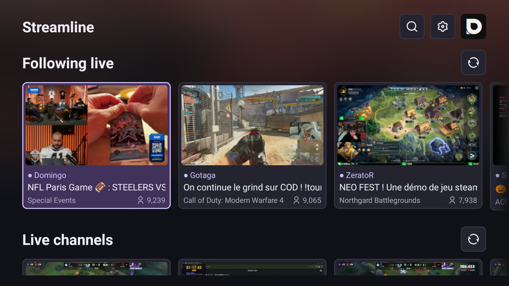

# Streamline

[](#installation-and-twitch-sign-in)
[](https://github.com/mbstdio/streamline/releases/download/v0.2.3/streamline-0.2.3.apk)

**Your Twitch streams, on the big screen.**

Streamline is a native Android TV app for finding your favorite Twitch channels, discovering live streams and watching them with chat. It runs on **Android TV 11 or later**.

- **Find your followed channels live** by connecting your Twitch account.
- **Discover new streams** through popular channels, categories and search.
- **Choose your video quality**: best available, automatic or a preferred resolution, with an audio-only mode.
- **Keep an eye on chat**, which you can show or hide during playback. The **Show chat by default** setting is enabled initially; changing it in settings or toggling chat in the player saves your choice for future streams and app restarts.
- **Enjoy an interface designed for TV.**
- **Built-in self-updates.**

### Table of contents

- [Screenshots](#screenshots)
- [Installation and Twitch sign-in](#installation-and-twitch-sign-in)
- [Updates](#updates)
- [Privacy and security](#privacy-and-security)
- [Development and testing](#development-and-testing)
- [Credits](#credits)

---

## Screenshots



## Installation and Twitch sign-in

### Download and install

Download the [stable APK 0.2.3](https://github.com/mbstdio/streamline/releases/download/v0.2.3/streamline-0.2.3.apk), then:

1. Copy the file to your Android TV box.
2. Open it with a file manager and allow that file manager to install unknown apps if Android prompts you.
3. Confirm the installation, then launch **Streamline** from the Android TV launcher.

**Requirements:** Android TV 11 or later and an Internet connection. The app is installed manually via APK; it is not published on the Play Store. Available video qualities depend on the tracks offered by Twitch and your TV box’s capabilities.

### Connect your account

1. Select the Twitch sign-in option in the app.
2. Follow the on-screen instructions to authorize the app on Twitch.
3. Find your followed channels that are live and start watching.

## Updates

Streamline silently checks for a new stable version at startup. When an update is available, a download icon appears next to search, providing access to version history and release notes.

You can also check manually using the update-check option in settings.

The download happens within the app, then the Android installer takes over. On first use, allow Streamline to install unknown apps, return to the app and select the install option. Android always asks for confirmation: installation is never silent. Leaving the update screen during a download cancels it.

## Privacy and security

- Account authorization uses Twitch’s official **Device Code Grant** flow. QR codes are generated locally, without a third-party service.
- Only the `user:read:follows` and `chat:read` permissions are requested: no permission to send messages or change follows.
- Access and refresh tokens are encrypted with AES-GCM using a non-exportable Android Keystore key. Android backups are disabled.
- Tokens are validated when first used, then at least hourly during authenticated use. They are refreshed automatically.
- Signing out clears the local session. You can also revoke authorization from your Twitch account’s connections page.
- Before opening the installer for an update, the app checks the package, version and signing key, as well as the SHA-256 checksum when provided.

## Development and testing

Streamline is built with **Java** and **Media3** for native HLS playback. Official Helix APIs handle the account, lists and search; chat uses IRC over TLS WebSocket.

### Build

Requirements: JDK 17 or 18, Android SDK (platform 35 and Build Tools 34.0.0), and Internet access to Google/Maven repositories. The wrapper provides Gradle 8.9. Locally downloaded tools are stored in `.tools/` (ignored by Git).

In PowerShell:

```powershell
.\scripts\build.ps1
```

The script builds a **signed, non-debuggable release**, runs release unit tests and lint, then produces `artifacts/streamline-0.2.3.apk`, its SHA-256 checksum and `artifacts/update.json` containing that checksum. Release signing must be configured first (see below). Artifact names follow the version declared in `app/build.gradle`.

### Release signing (one-time setup)

Create a dedicated signing key with the JDK's `keytool` (use its full path if it is not on `PATH`):

```powershell
keytool -genkeypair -v -storetype PKCS12 -keystore "$env:USERPROFILE\.gradle\streamline-release.jks" -alias streamline -keyalg RSA -keysize 3072 -validity 10000
```

Create `%USERPROFILE%\.gradle\streamline-signing.properties` (or the same file under a custom `GRADLE_USER_HOME`) **outside the repository**, with these values. Use forward slashes in the keystore path:

```properties
STREAMLINE_KEYSTORE=C:/Users/YOUR_USER/.gradle/streamline-release.jks
STREAMLINE_KEY_ALIAS=streamline
STREAMLINE_STORE_PASSWORD=YOUR_STORE_PASSWORD
STREAMLINE_KEY_PASSWORD=YOUR_KEY_PASSWORD
```

For a PKCS12 keystore, use the same password for the store and key. The same environment variables can be used instead and take precedence over the file. Restrict access to the credentials file and keystore to your user. Never commit or publish either file. Keep a secure backup of the key and passwords: losing them prevents future updates to existing installations. Missing signing credentials must be supplied before a release build; there is no fallback to a debug key.

For local development without release credentials, debug builds remain available. With an SDK configured through `ANDROID_HOME` or `local.properties`, use the wrapper directly:

```powershell
.\gradlew.bat assembleDebug testDebugUnitTest lintDebug
```

<details>
<summary>Install with ADB</summary>

Enable developer mode and network or USB debugging if your device supports it, then accept the connection on the TV. Network debugging availability and its port depend on the device model and firmware.

```powershell
# Example only if network debugging is exposed on port 5555:
.\.tools\android-sdk\platform-tools\adb.exe connect TV_BOX_IP_ADDRESS:5555
.\.tools\android-sdk\platform-tools\adb.exe install -r .\artifacts\streamline-0.2.3.apk
```

Disable debugging after installation if you no longer need it.

</details>

### Verification

```powershell
.\gradlew.bat testReleaseUnitTest lintRelease
# Optional network test, without an account, using a currently live channel:
node .\scripts\check-twitch.mjs riotgames
```

Unit tests cover playlists, channel names, device-code sign-in, token refresh and storage, client and permission validation, invalid responses and IRC parsing. Before publication, verify the release APK with the SDK's `apksigner verify --verbose --print-certs` and confirm with `aapt dump badging` that it has no `application-debuggable` flag.

Additional tests run on an Android TV device or emulator: sign-in, QR codes, navigation, player controls, cards and focus restoration. Real stream previews require an already authorized account; the optional video test uses a live channel with anonymous playback.

```powershell
# With an ADB device connected; replace riotgames if the channel is offline:
.\gradlew.bat connectedDebugAndroidTest '-Pandroid.testInstrumentationRunnerArguments.liveChannel=riotgames'
```

Testing on a real TV box is still necessary: sign-in, navigation, video and audio, available qualities, chat, network interruptions and standby. Automated tests do not replace these hardware checks.

<details>
<summary>Code organization and Twitch integration</summary>

Java sources are located in `app/src/main/java/tv/streamline/app/`:

- `MainActivity`: Android lifecycle and navigation between screens.
- `CatalogScreen`, `CatalogCards`: catalog, search and cards. `CatalogState` stores data, pagination and selections without view references; `CatalogRepository` groups Helix requests.
- `PlayerScreen`: player interface. `PlaybackController` owns the Media3 player and quality rules; `ChatPanel` manages chat and its display.
- `LoginScreen`, `SettingsScreen`: sign-in and settings.
- `Screen`: shared visual primitives, image loading deferred until views are visible, and protection against asynchronous results from a previous screen. `ThumbnailLoader`: a 32 MiB decoded-image memory cache for the activity’s lifetime, shared in-flight downloads, and cancellation when a screen no longer needs them. Cached images are applied immediately when returning to a screen.
- `TwitchApi`, `SessionStore`, `ChatClient`, `IrcMessage`: Twitch access, encrypted storage and the chat protocol.

Leaving a screen invalidates its asynchronous updates. The catalog preserves its state without retaining old views.

Playback adapts `getChannelPlaylist` from `../streamline/src/lib/twitch.ts`: a persisted `PlaybackAccessToken` GraphQL request, construction of the signed `usher.ttvnw.net/api/v2/channel/hls/<login>.m3u8` URL, then native HLS playback. The `Origin` and `Referer` headers from `../streamline/public/background.js` are also applied to playlists and segments. No Firefox cookies are retrieved.

The Twitch application must be registered as a **Public** client, with a verified owner account and two-factor authentication. If the console requires a redirect URL, `http://localhost:3000` works; the device-code flow does not use it. The embedded Client ID is not a secret.

</details>

<details>
<summary>Publishing updates</summary>

The update check queries `https://cdn.infiniteloop.ch/streamline/update.json` at startup, without periodic checks or another request when returning to the home screen. A manual check always makes a new request.

The manifest uses the `stable`, `beta` and `versions` fields from the root `update.json` file. Only the stable channel is offered for installation; all listed versions are displayed and compared numerically against the installed version.

Each entry contains `version`, `apk` and `changelog` (a list of strings), plus an optional `sha256` field containing the APK’s hexadecimal checksum. URLs must use HTTPS on `cdn.infiniteloop.ch`, without redirects.

Before installation, the app requires the correct package, the expected version, a strictly higher `versionCode` and the same signing key. The checksum is checked when provided. **Always keep the signing key and increase `versionCode` for each release.** The rebuilt 0.2.3 uses `versionCode` 7. Publish the generated APK under `apk/` and the matching `artifacts/update.json` as the CDN's `update.json`; upload the APK before the manifest and invalidate cached copies when replacing 0.2.3. Do not publish the old debug APK or mix a manifest and APK from different builds.

</details>

<details>
<summary>Android TV emulator troubleshooting</summary>

If the Back and Home buttons work through `adb shell input keyevent` but not from the emulator sidebar, check `%USERPROFILE%\.android\avd\streamline-tv-30.avd\config.ini`: `hw.keyboard = yes` is required with this TV profile. Stop the emulator before changing this setting, then restart it without wiping its data. This issue was reproduced and fixed with Android Emulator 37.2.12 and the Android TV 11 image.

The following script opens Android settings and tests the actual window buttons, without ADB input injection. It finishes on the Android TV home screen:

```powershell
.\scripts\check-emulator-controls.ps1
```

</details>

## Credits

Icons by [Remix Icon](https://remixicon.com), under the [Remix Icon License v1.0](https://github.com/Remix-Design/RemixIcon/blob/master/License), adapted as Android vector drawables.
